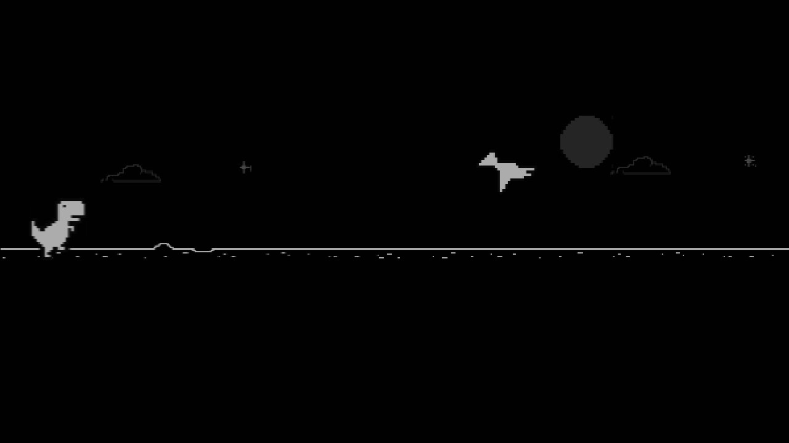

# Dino Runner

The T-Rex game from Chrome's offline page as an Android TV screensaver. A bot plays it on its own, in
silence, jumping the cacti and ducking the birds while the speed climbs and night falls now and then.
Pick up the remote to play it yourself:

| Key | What it does |
|---|---|
| OK or Up | Jump (and take over from the bot, with the game's sounds on) |
| Down | Duck, or drop faster in the air |
| Left or Right | Hand the game back to the bot, which plays silently again |
| Volume | Changes the volume as usual |
| Back, Home or any other key | Leave the screensaver |

After 20 seconds without a key the bot takes over again on its own. The page is dark (the same
invert filter Chrome uses for its night mode), so it is not a white screen in a dark room.

It is also an app with a tile, and on the [cleanyourtv](https://github.com/Gathin23/cleanyourtv)
launcher's Home a module card, **Dino Runner**: press OK on it to start the game at once, with the same
game keys, and Back to leave. The screen stays on while the card's game is open.



- Package: `io.github.oussama22.dinorunner`
- Tested on: Skyworth SWTV-24AE-FHD (Google TV 14, MediaTek, 1 GB RAM)

## Permissions

None. No network access (no `INTERNET` permission): the game, its pictures and its sounds are in the
APK, and nothing leaves the TV. No background service: it runs only while the screensaver or the
card's screen is showing.

## Build and install

Download `dino-runner-<version>.apk` from the [latest release](https://github.com/ous-sama22/dino-runner/releases/latest),
check it against the SHA-256 in the release notes, then install it with the TV's network debugging on:

```bash
adb connect <tv ip>:<port>
adb install -r dino-runner-1.0.apk
```

Or build it yourself, with JDK 17 and Android SDK 34 (platform 34, build-tools 34.0.0):

```bash
./gradlew assembleRelease
adb install -r app/build/outputs/apk/release/app-release.apk
```

On Windows run `gradlew.bat assembleRelease`.

The APK is signed with a debug key, so it installs over ADB. A build signed with another key (your own
build, or one from another release) does not install over it: uninstall the old one first
(`adb uninstall io.github.oussama22.dinorunner`).

## Use it as the screensaver

Settings > Device Preferences > Screen saver > **Dino Runner** (the menu's name depends on the TV), or:

```bash
adb shell settings put secure screensaver_components io.github.oussama22.dinorunner/.DinoDream
```

It starts after the TV's screensaver delay, which on Android TV is the screen-off timeout. To make it
start after 5 minutes idle:

```bash
adb shell settings put system screen_off_timeout 300000
```

To see it without waiting, some TVs can start the screensaver now:

```bash
adb shell am start -n com.android.systemui/.Somnambulator
```

On the Skyworth it was tested on that activity does not exist and `cmd dreams start-dreaming` needs
root, so either wait for the delay or open the app, which runs the same game.

## How it works

The game is Chromium's own code, unchanged, in `app/src/main/assets/dino/` (see [CREDITS.md](CREDITS.md)).
`index.html` loads it in a WebView, and `bot.js` plays it: it reads the next obstacle from the game,
jumps when it is about twelve frames away, ducks under a bird at head height and lets a high one fly
over. `bot.js` also mutes the game while the bot plays. The Java code only shows the page and sends
it the remote's keys: `DinoGame.java` sets up the WebView and maps the keys, `DinoDream.java` is the
screensaver and `DinoActivity.java` is the app's screen.

It uses about 50 MB of memory while it runs (51 MB PSS on the 1 GB TV above), and nothing of it
keeps running once it closes.

To change the bot's timing, edit `reach` in `bot.js`; `MANUAL_MS` is how long you keep the game after
your last key, and `RESTART_MS` is the pause on the game-over screen before the bot starts again.

## Remove

```bash
adb uninstall io.github.oussama22.dinorunner
```

If it was the screensaver, pick another one in Settings.

## Licence

This project's own code (the Java files, `bot.js`, the page around the game, the banner and the icon) is
under the MIT licence in [LICENSE](LICENSE). The game's code, sprites and sounds are Chromium's, under
their BSD licence: see [CREDITS.md](CREDITS.md). Google does not endorse this project.
